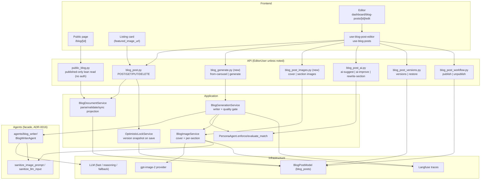
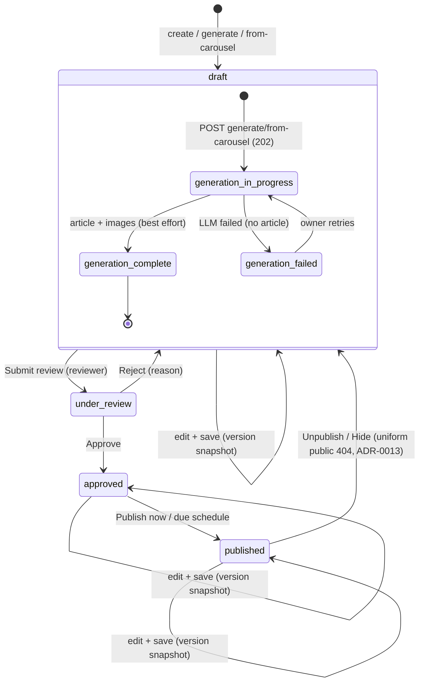
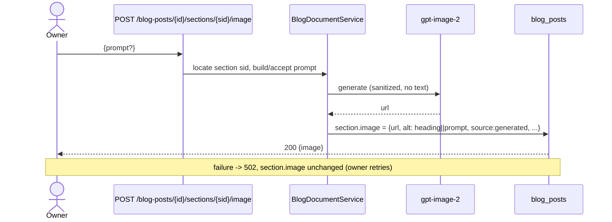
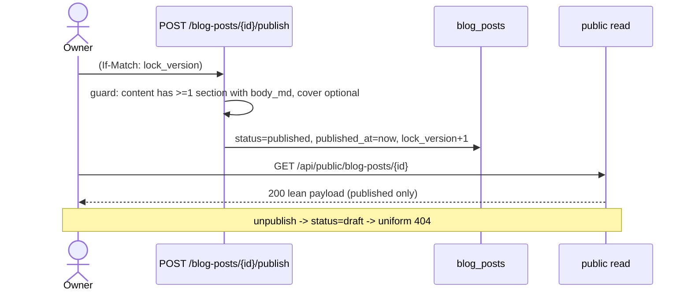
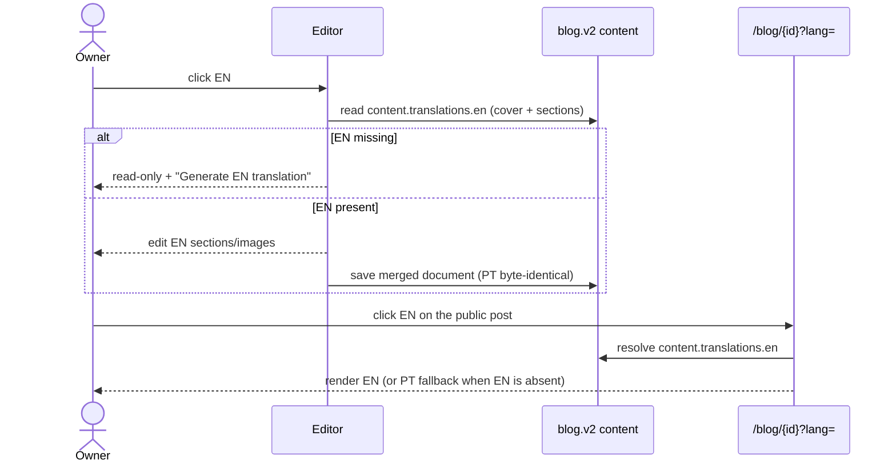

# Blog post document model — design companion to ADR-0025

Status: proposed (companion to [ADR-0025](../decisions/0025-blog-post-owns-structure-voice-and-images.md))
Date: 2026-10-18
Scope: the detailed design for making a blog post its own document (structure, voice, images).

This document complements ADR-0025. It carries the component and state diagrams, the full JSON
schema, the cutover algorithm with a worked before/after, the test strategy and the open
questions. Normative rules live in the ADR; this file explains *how*.

---

## 1. Component diagram



`BlogDocumentService` is the **only** place that reads/writes the blog document shape and keeps
`featured_image_url` in sync with `content.cover.url`. Every other component depends on it (or on
the pure `parse_blog_content` helper), so the v2 shape logic lives in exactly one place. There is no
v1 write path: after the AE-0423 cutover command every row is v2, and the parser rejects any non-v2
write. Until the command runs, reads adapt legacy markdown in memory (text-only v2) so the public blog
never 500s; that adapter is removed in AE-0428.

---

## 2. State diagram



Notes:

- `hidden` is not a separate stored status: unpublish sets `status = "draft"`. The dashboard may
  label a never-published draft that was previously published as "hidden" — the invariant is only
  "non-published ⇒ public 404" (ADR-0013).
- `under_review` / `approved` and scheduled publication **are part of the editor UX** (owner
  revision): `draft → under_review → approved → published`, or `approved → scheduled` with a future
  `scheduled_publish_at`. The existing routes are kept; the owner can self-approve behind
  `BLOG_ALLOW_SELF_REVIEW` in the single-author deployment.
- Generation is **per-post metadata** (`ai_generation_metadata.generation.status`), orthogonal to
  the editorial status: a post can be `draft` + `generation_in_progress`.
- `generation_failed` never loses the row: the draft exists with whatever sections were written.

---

## 3. Sequence diagrams

### 3.1 Generate from a carousel

```mermaid
sequenceDiagram
    actor Owner
    participant API as POST /blog-posts/from-carousel
    participant DB as blog_posts
    participant Gen as BlogGenerationService
    participant W as BlogWriterAgent
    participant Q as Quality gate
    participant IMG as gpt-image-2

    Owner->>API: {project_id, persona_id?}
    API->>DB: guard (project exists, no live blog row)
    API->>DB: insert draft {schema:"blog.v2", sections:[], quality:null, generation:in_progress}
    API-->>Owner: 202 {id}
    API->>Task: schedule tracked asyncio task (lease, heartbeat)
    Task->>Gen: run(id, inputs)
    Gen->>W: write article (findings+outline+notes, persona guide+samples, PT+EN)
    W-->>Gen: sections + cover_prompt + translations.en
    Gen->>Q: evaluate_match(body) + repetition scan
    Q-->>Gen: score / rewrite needed
    opt score < 70 or repetition
        Gen->>W: one rewrite pass
        W-->>Gen: revised sections
    end
    Gen->>DB: store N sections + PT/EN quality scores (If-Match/versioned write)
    par cover then sections (bounded concurrency, cost cap)
        Gen->>IMG: generate cover
        Gen->>IMG: generate per-section images
    end
    IMG-->>Gen: bytes -> blog-images store (provider URL never persisted)
    Gen->>DB: attach canonical urls; failures -> image=null + errors[]
    Gen->>DB: featured_image_url = cover.url; generation=complete|partial
    Owner->>API: GET /blog-posts/{id} (poll)
```

**Always a draft.** No branch publishes the post. If the carousel is later made public, the blog row
is untouched.

**Execution and recovery.** The 202 is served before the pipeline runs. The task is the repo's
existing tracked fire-and-forget pattern (`asyncio.create_task` + `_background_tasks` set +
cancel-on-shutdown, like `editorial_workflow_resume_runner.schedule_background_resume`), not FastAPI
`BackgroundTasks`/Celery. It writes `generation = {status, started_at, heartbeat_at, lease_id,
attempt, errors}` and heartbeats; writes are lease-fenced. `BLOG_GENERATION_TIMEOUT_SECONDS` (default
900) bounds the run. A restart kills the task, so the existing `run_workflow_workers` tick (default
every 60 s) reaps rows whose heartbeat is older than `BLOG_GENERATION_STALE_SECONDS` (default 180) to
`failed` / `ERR_GENERATION_INTERRUPTED` / `recoverable=true`, preserving partial content; retry is
owner-triggered (no automatic re-enqueue, to avoid duplicate spend).

**Section/image count comes from the carousel.** The writer emits one section per slide, so
`len(sections) == project.slide_count` when set (the value persisted at carousel creation from
`resolved_slide_count()`: POV default 9, Radar IA 7–8; `content_mode.py:51-55`,
`CarouselProject.slide_count`, `carousel.py:191`), else the deck size derived from `slides_config`
via `slide_count_from_config()` (the same helper the design payload uses), else the content-mode
default. Image generation therefore produces that many section images + 1 cover. Standalone
generation uses the same content-mode default because it has no project. There is no
`BLOG_IMAGE_MAX`; `BLOG_IMAGE_COST_CAP` is the only ceiling.

#### As built (AE-0425)

- **Pipeline:** `BlogWriterAgent.draft` (fast) → `normalize_section_count` (merge extras / split long
  sections on paragraph breaks, else `section_count_mismatch`) → `BlogQualityGate` per language (PT
  strips any research sentence copied verbatim, then `PersonaAgent.evaluate_match` + the
  deterministic scan; `< 70` or any finding → `judge` on the **reasoning** model writes revision
  notes → exactly one `rewrite` on the fast model → re-scored) → store the image-less document →
  `BlogImageService` (cover first, `BLOG_IMAGE_CONCURRENCY`, `BLOG_IMAGE_COST_CAP` in USD at
  ~$0.25/image) → store the document with images → `complete` / `partial`.
- **Run state:** `ai_generation_metadata.generation = {status, kind, started_at, heartbeat_at,
  finished_at, lease_id, attempt, errors[], recoverable, request, warnings[], image_slots,
  image_count}`. Every write is a compare-and-set on `generation.lease_id` (JSON path) **and**
  `lock_version`; a retry and the reaper rotate the lease and bump `lock_version`.
- **Retry:** `POST /blog-posts/{id}/generation/retry` (same row, new attempt) — `from-carousel` 409s
  for any existing row, so the retry cannot go through it.
- **Images store:** `<CAROUSEL_OUTPUT_DIR>/blog-images/<post_id>/<uuid>.jpg`, served by
  `GET /api/blog-images/<post_id>/<file>` (public when the post is published, author/admin
  otherwise). EN reuses the PT image file with its own alt text.
- **Private carousel:** the run records `warnings: ["carousel_private"]`; the editor banner warns
  that the published post would 404 and links to the carousel's visibility control.

### 3.2 Generate standalone

Same as 3.1 with the input being `{topic, persona_id?, language?, source_urls?[]}`; the writer gets
the topic and the URLs as references (never fetched — no SSRF) instead of a carousel artifact.
`origin = "standalone"`, `project_id = null`, and the post takes the writer's title.

### 3.3 Edit a section image



`alt` defaults to the section heading (never empty). Regenerate replaces `image`; remove sets it to
`null`; `PATCH` edits alt/caption only.

### 3.4 Publish



Publishing validates the document shape (at least one non-empty section) and requires `status =
approved`; a `draft` cannot jump straight to `published`. "Publish now" on a draft first runs
submit-review + self-approve when `BLOG_ALLOW_SELF_REVIEW` is enabled; when it is disabled the
button is hidden and the editor links to the review flow. A missing cover is allowed: the public
renderer uses a neutral default and cards/OG use a deterministic fallback (never a carousel slide).

### 3.5 Review + scheduled publish

```mermaid
sequenceDiagram
    actor Owner
    participant Editor
    participant API as blog_post_workflow
    participant DB as blog_posts
    participant Sweep as ScheduledPublishService

    Owner->>Editor: Submit for review (reviewer)
    Editor->>API: POST /blog-posts/{id}/submit-review?reviewer_id=
    API->>DB: status=under_review, submitted_for_review_at=now
    alt approve
        Owner->>Editor: Approve
        Editor->>API: POST /blog-posts/{id}/approve
        API->>DB: status=approved, approved_at=now
        alt publish now
            Owner->>Editor: Publish
            Editor->>API: POST /blog-posts/{id}/publish
            API->>DB: status=published, lock_version+1
        else schedule
            Owner->>Editor: pick date/time
            Editor->>API: POST /blog-posts/{id}/schedule {scheduled_publish_at}
            API->>DB: scheduled_publish_at (lead time validated)
            opt cancel / edit
                Owner->>Editor: Cancel schedule or edit content
                Editor->>API: DELETE /schedule | PUT /blog-posts/{id} (If-Match)
                API->>DB: clear scheduled_publish_at; edit -> status=draft
            end
            Sweep->>DB: due approved posts -> published
        end
    else reject
        Owner->>Editor: Reject (reason)
        Editor->>API: POST /blog-posts/{id}/reject?reason=
        API->>DB: status=draft, editor_comments += reason
    end
```

The routes already exist (`api/routes/blog_post_workflow.py`); the plan adds editor controls and
feature tests. Any content edit while `under_review`/`approved`/scheduled resets `status = draft`
and clears `scheduled_publish_at`, so a review never approves unseen content and the sweep skips
edited posts. `BLOG_ALLOW_SELF_REVIEW` (default **false**) bypasses only the submit-time
`ERR_SELF_REVIEW` check and stores the author as `reviewer_id`, so the existing
`assert_blog_post_reviewer_or_admin` accepts the subsequent approve/reject.
`unpublish` remains the way back to `draft` (uniform public 404, ADR-0013).

### 3.6 Switch PT/EN



The editor persists the whole v2 document on save; the active language is the only subtree mutated.
The public page's `?lang=` switch is content language, independent of the next-intl UI locale.

---

## 4. Full JSON schema (`blog_posts.content`, `blog.v2`)

```jsonc
{
  "schema": "blog.v2",
  "cover": Image | null,
  "sections": [Section, ...],          // 1..N, ordered; ids unique (0 only while in_progress)
  "translations": {
    "en": { "schema": "blog.v2", "cover": Image|null, "sections": [Section, ...],
            "quality": Quality|null }
  },
  "quality": Quality|null              // null = not scored (in-progress or migrated)
}

// Image
{
  "url": "string",                     // absolute or CDN-resolved
  "alt": "string",                     // REQUIRED, non-empty
  "caption": "string|null",
  "source": "generated",               // "generated" now; "upload" reserved
  "prompt": "string",                  // sanitized prompt actually sent
  "model": "string",                   // e.g. "gpt-image-2"
  "created_at": "ISO-8601"
}

// Section
{
  "id": "sec_<uuid4>",
  "heading": "string|null",            // null = lede/intro section
  "body_md": "string",                 // sanitized markdown, no leading H1
  "image": Image | null
}

// Quality (PT top-level; EN uses translations.en.quality, same shape)
{
  "voice_score": 0..100,
  "voice_breakdown": {                 // PersonaAgent.evaluate_match fields
    "tone_match": number, "sentence_structure_match": number,
    "opinion_strength": number, "originality": number,
    "human_authenticity": number, "overall": number, "suggestions": [string]
  },
  "repetition": { "repeated_sentences": [string], "banned_phrases": [string] },
  "rewrite_passes": integer,
  "checked_at": "ISO-8601"
}
```

### Validation rules (application layer, ADR-0006)

| Field | Rule | Layer |
|---|---|---|
| `schema` | must equal `"blog.v2"`; any other value is rejected (no v1 path) | backend + frontend parse helper |
| `sections` | >= 1 on normal writes (0 allowed only while `generation.status == "in_progress"`); each `id` unique; `body_md` <= `BLOG_SECTION_MAX_CHARS` | Pydantic on write |
| `heading` | <= 200 chars, no `#` | Pydantic |
| `image.alt` | non-empty | Pydantic; renderer falls back to heading |
| `image.url` | `https:` or same-origin path | Pydantic |
| `translations.en` | same shape or absent; includes its own `quality` (gated like PT) | Pydantic, optional |
| `quality` | valid Quality object or `null` (not scored) | Pydantic, optional |

`parse_blog_content` is strict: it validates and returns the document, or raises
`InvalidBlogDocumentError`. It never coerces a legacy string into a section. The AE-0423 cutover is
the only bridge from the old shape. To keep cutover failures from taking the public blog down, the
**read** path catches `InvalidBlogDocumentError` when the row still has legacy markdown and synthesizes
an in-memory text-only v2 document with the same fence-aware splitter (`cover:null`,
`image:null`, `quality:null`), emitting `blog_v2_non_migrated_rows`. This is a temporary fail-safe,
not a v1 write/persist path, and AE-0428 removes it after `--verify` reports zero non-v2 rows.

The public lean allow-list (ADR-0013) is unchanged, but `content` is **projected**: only
`schema`, `cover{url,alt,caption,source,created_at}`, `sections[{id,heading,body_md,image{...}}]`,
and the same for `translations.en` are serialized. `quality`, `image.prompt`, `image.model`, and
generation metadata are editor-only and must be absent from the public payload (contract test).

---

## 5. Cutover: one-shot command (not Alembic)

The rewrite is a pure function, unit-tested, applied by
`python -m rag_backend.scripts.blog_v1_to_v2` in the freshly built backend image.

**Why not Alembic.** `.github/workflows/deploy.yml:255-262` disables migrate-on-deploy: prod was
never `alembic stamp`ed and the chain had two heads (`0011_drop_audit_stream_entry_id` +
`e5f6a7b8c9d0`), so `alembic upgrade head` aborted and took prod down on 2026-06-18; prod still
bootstraps with `create_all`. Making the head-merge + one-time stamp reconcile
(`docs/deployment/prod-migration-reconcile.md`, AE-0207) a prerequisite would couple a safe JSONB
rewrite to an unrelated, risky schema operation. The command needs no DDL and no Alembic state. The
Alembic reconcile remains a **separate** prerequisite for schema migrations.

**Modes.** `--dry-run` (counts + samples, no writes), `--apply` (batched, idempotent, one transaction
per batch under `pg_advisory_xact_lock`), `--verify` (exit non-zero if any row is still non-v2),
`--rollback` (re-join sections; only with a code rollback). `--apply --verify` can be combined.
`--verify` uses the same strict `parse_blog_content` as the read path (a `blog.v2` marker alone is not
enough); `--apply` also repairs a v2-marked row by dropping only its translations that do not parse.

**Deploy order.** `deploy.yml` builds the image → `down` (no old/new overlap) → starts Postgres →
runs the command with `--apply --verify` using the new image → `up -d`. The step never blocks the stack: its exit code is captured, `up -d` always runs (the read fail-safe keeps non-migrated rows rendering), and the deploy job fails at the end so the failure alerts (an abort here would leave the stack down, the 2026-06-18 failure mode).
The operator can re-run the same command ad hoc.

```
for each row in blog_posts:
    content = row.content
    if isinstance(content, dict) and content.get("schema") == "blog.v2":
        continue                                   # idempotent
    legacy = extract_legacy_markdown(content)      # markdown|body string ONLY; else ""
    if legacy is None:
        legacy = ""                                # never str(dict) -> garbage sections
    row.content = {**split_document(legacy), "translations": {}}
    for lang, translated_md in (content.get("translations") or {}).items():
        if not isinstance(translated_md, str):
            continue                               # drop non-strings, never str(dict)
        row.content["translations"][lang] = split_document(translated_md)
    row.featured_image_url = None                  # keep the cover projection invariant

def split_document(markdown):
    chunks = split_on_h2(markdown)                 # fence-aware: ignore ## inside ``` blocks
    if chunks and strip_leading_h1(chunks[0]).strip() == "":
        chunks = chunks[1:]                        # drop an H1-only lede
    sections = []
    for chunk in chunks:
        heading, body = parse_chunk(chunk)         # "## X\nbody" -> ("X", "body")
        if not body.strip():
            continue                               # skip empty sections
        sections.append({"id": new_section_id(), "heading": heading,
                         "body_md": body, "image": None})   # raw bytes; no cutover sanitize
    if not sections:
        sections = [{"id": new_section_id(), "heading": None, "body_md": "", "image": None}]
    return {"schema": "blog.v2", "cover": None, "sections": sections, "quality": None}
```

The real v1 shape is `{"markdown": "...", "translations": {"en": "..."}}`; `blog_translations` is
`dict[str, str]` (language → markdown). Each language is split with the **same** rules, so
`content.translations.en` becomes a full v2 document, not a string.

Properties:

- **idempotent** — skipped once `schema == "blog.v2"` (a re-run is a no-op).
- **verified** — `--verify` exits non-zero on any row whose content fails the strict parse
  (including a bad translation); the deploy still brings the stack up and fails the job afterwards.
- **versions migrated** — every `version_history[*].snapshot` is rewritten with the same rules (and
  re-joined on `--rollback`), so a pre-cutover version stays restorable as a strict v2 write.
- **cover projection reversible** — a cleared `featured_image_url` is stashed in
  `ai_generation_metadata.blog_v2_cutover` (never public) and restored by `--rollback` when no cover
  was set since.
- **forward-only at the application level** — after cutover there is no v1 persist path; the strict
  parser rejects non-v2 writes. The temporary read fail-safe (below) is removed in AE-0428.
- **reversible at the data level** — `--rollback` (run from the new image **before** reverting the
  app code) re-joins `## {heading}\n\n{body_md}` into flat markdown for PT and each translation.
  Section body bytes are preserved exactly (no sanitization); headings are re-serialized as
  `## {heading}`; the title H1 is not restored (it lives in the column). Meaningful only with a code
  rollback to the pre-B release.
- **fence-safe.** A `## ` line inside a fenced code block is not a section boundary.
- **no coercion.** A non-markdown content object becomes an empty section, never `str(dict)`.
- **translations preserved** — every non-blank string translation is converted; non-string and
  blank entries are dropped (a blank translation fell back to PT in v1 and still does).
- **oversized sections** are not silently truncated; the verification report flags them for AE-0426.
- **image-free** — v1 images were injected at read time from `design.images.slides`
  (`design_token_utils.py:216-221,280`) and never stored; nothing to carry.

### Read fail-safe (temporary)

If the command has not run, `BlogDocumentService`/the public projection catches
`InvalidBlogDocumentError`, synthesizes a text-only v2 document from legacy `markdown` in memory, and
emits `blog_v2_non_migrated_rows`. It never returns a 500, never reads carousel slides, and cannot
persist. Writes fail closed; the editor surfaces the error and AE-0424 adds a clear “migration pending”
banner. AE-0428 deletes the adapter after `--verify` is zero in prod.

### Cutover runbook

```
docker compose -f docker-compose.prod.yml run --rm --no-deps backend \
  python -m rag_backend.scripts.blog_v1_to_v2 --dry-run
docker compose -f docker-compose.prod.yml run --rm --no-deps backend \
  python -m rag_backend.scripts.blog_v1_to_v2 --apply --verify
```

`--dry-run` shows per-row PT/translation counts and flags oversized sections. `--verify` is also safe
to run at any time as a health check (exit 0 = all rows v2).

### Hidden-post rebuild runbook (AE-0426)

Posts hidden by AE-0422 keep a durable `ai_generation_metadata.hidden_bad_post` marker. Rebuild them
through the writer pipeline **inside the prod backend container**, so generated images land in the
mounted `carousel_output_dir/blog-images` volume (running it from a bare checkout writes images
outside that store):

```
docker compose exec backend \
  python -m rag_backend.scripts.rebuild_hidden_posts --dry-run
docker compose exec backend \
  python -m rag_backend.scripts.rebuild_hidden_posts --apply --only <post-id>
```

Start with `--only <post-id>` (repeatable) for one post. `--apply` otherwise **defaults to
`--max-posts 1`** (an apply-only spend cap); raise it explicitly for a batch
(`--apply --max-posts 10`). `--limit N` narrows the selection list first; the summary reports any rows
omitted by either cap. The dry run is never truncated by `--max-posts`, so the full target list (and
its missing-material skips) stays visible. The dry run performs the
free DB-only material checks, so missing carousels and carousels without `long_form_notes` show as
skips before any paid generation.

The command selects marked rows whose `rebuilt_at` is absent, reuses each existing row (no duplicate)
and writes a `blog.v2` **draft** with cover/section images and stored PT/EN scores. Starting an
attempt replaces the hidden legacy body with a fresh v2 document (the AE-0424 slot path only edits
v2) and the draft takes the writer's title. Published rows
are skipped as `currently_published` unless `--include-published` is passed (a rebuild flips them
back to `draft`). It never publishes; the owner reviews and publishes. A successful or `partial`
attempt stamps `hidden_bad_post.rebuilt_at`, so re-runs are no-ops; `failed` leaves it unset for a
retry. The summary prints selected/rebuilt/skipped/failed (and omitted), the process exits non-zero
when any post failed, and each post emits its own Langfuse trace (flushed before exit).

### Worked example (real v1 PT post)

**Before** (`content`):

```json
{ "markdown": "# GPT 5.6 saiu\n\n## O que aconteceu\n\nA OpenAI lançou o GPT 5.6...\n\n## Por que importa\n\nPara quem desenvolve software, ...\n" }
```

Rendered today with a carousel design whose `images.slides` == `rendered_slides_pt`, so the two `##`
blocks get Instagram-card screenshots with baked-in text (F-01) and empty `alt=""` (F-07).

**After** (migrated `content`):

```json
{
  "schema": "blog.v2",
  "cover": null,
  "sections": [
    { "id": "sec_9a02…", "heading": "O que aconteceu", "body_md": "A OpenAI lançou o GPT 5.6...", "image": null },
    { "id": "sec_71bd…", "heading": "Por que importa", "body_md": "Para quem desenvolve software, ...", "image": null }
  ],
  "translations": {},
  "quality": null
}
```

The leading `# GPT 5.6 saiu` is stripped and its now-empty chunk is dropped, so the migrated document
has exactly the two `##` sections. The public page renders them with their own (currently null → no)
images, the title once, and no `/slide-images/` URL. Images are added later by the owner or the
E-ticket rebuild. If the row also had `translations.en`, that markdown is split with the same
algorithm into `content.translations.en = {"schema":"blog.v2","cover":null,"sections":[…],
"quality":null}`; the top-level `translations` is never a string after the cutover.

---

## 6. Test strategy

### Backend

- **Unit**
  - `parse_blog_content` — valid v2; missing keys; malformed JSONB; a non-v2 shape raises
    `InvalidBlogDocumentError` (no coercion).
  - cutover `blog_v1_to_v2` — `--apply` idempotent (run twice = same), `--verify` exits non-zero on
    a seeded non-v2 row, `--rollback` preserves section body bytes, fence-aware split (`## ` inside a
    code fence is not a boundary), PT + `translations.en` split with the same rules, non-string
    translation dropped, empty row, H1-only stub, multi-`##` rows, a chunk with an empty body,
    headings with special chars, non-markdown `content` (empty section, never `str(dict)`),
    `featured_image_url` cleared with the cover.
  - read fail-safe — a non-migrated legacy row renders as text-only v2 (no slide URL, no 500),
    emits the metric, and refuses writes.
  - `BlogDocumentService` — `featured_image_url` stays synced with `cover.url`; section id
    uniqueness; alt-non-empty enforcement.
  - quality gate — `evaluate_match` < 70 triggers exactly one rewrite; repetition detector finds a
    seeded repeated sentence; banned-phrase list is data-driven.
  - image service — provider bytes persisted to the blog-images store (canonical URL only); failure
    ⇒ `image=null` + `errors[]`, draft survives; cost cap enforced; `sanitize_image_prompt` applied;
    writer section count validated against `project.slide_count` (else the deck size from
    `slides_config`, else the content-mode default; standalone uses the default) with N+1 image
    slots and stored images `<= N+1`.
  - `ai-suggest` — fenced envelope stripped; nested envelope unwrapped; non-JSON degrades to raw.
  - version snapshot appended on PUT in the same transaction.
  - review/schedule guards — `submit-review` requires a reviewer (or `BLOG_ALLOW_SELF_REVIEW`,
    which stores the author as reviewer), `approve`/`reject` only from `under_review`, `schedule`
    only from `approved` and never in the past, `publish` only from `approved`, cancel-schedule
    leaves `approved`, and an edit after approval resets to `draft` + clears the schedule.
- **Contract** (`.feature` under `backend/tests/features/`)
  - `blog_generate_ae0425.feature` — from-carousel + standalone always draft; 202; quality gate;
    image failure; projection sync.
  - `blog_sections_ae0423.feature` — model + one-shot cutover (dry-run/apply/verify, fence-safe, raw
    body, PT + EN translation) + deploy ordering + strict writes + read fail-safe + public v2 render +
    public projection (no quality/prompt/model) + EN gate.
  - `blog_post_ai_contract_ae0424.feature` — strict JSON suggest; rewrite-section; versions on save;
    If-Match on every content mutation; image persistence; full review/schedule/self-review/edit-reset.
  - `blog_cleanup_ae0428.feature` — design payload drops `blog_image_map`; code-only static guard +
    seeded violation; live distribution helpers/columns preserved.
- **Integration** — PUT with `If-Match` conflict (409) still holds (AE-0296); publish guard rejects
  an empty document (422); a cutover-verification check asserts zero non-v2 rows after `--apply
  --verify`; a simulated restart leaves the generation row `failed`/recoverable, not `in_progress`.
- **Cleanup (AE-0428)** — code-only grep/static test (`*.py`, `*.ts`, `*.tsx`) asserts no
  `blog_image_map` and no v1 builder symbol remains; YAML prompts are excluded (the frozen carousel
  prompt still mentions the key and the parser ignores it); a seeded-violation test proves the guard
  fires; Knip runs without the removed baseline entries.

### Frontend

- **Unit (Vitest + RTL + MSW)**
  - `parse-blog-content` — valid v2; non-v2 rejected (no v1 branch).
  - section card — edit heading/body, reorder keeps image, add/delete section.
  - image slot — generate/regenerate/remove, alt/caption, visible retry on failure.
  - unsaved-changes guard fires; Publish/Unpublish call the hooks; Submit review / Approve /
    Schedule call the existing workflow hooks.
  - language buttons — PT/EN switch the edited document; an EN edit never mutates PT; a missing EN
    document is read-only with a generate-translation action.
  - public renderer — renders `cover` + per-section `image` with the stored `alt`; never a
    `/slide-images/` URL; one H1; PT/EN switch the rendered document (PT fallback); never fetches
    `/api/carousels/{id}/blog` or legacy `/blog/{project_id}` content (carousel-origin post with no
    v2 row → 404); null-cover card fallback.
- **Feature specs** — `blog_sections_ae0423.feature`, `blog_editor_ae0424.feature`,
  `blog_generate_ae0425.feature`, `blog_no_carousel_slides_ae0422.feature`; retired/rewritten:
  `blog_clean_slides.feature`, `blog_content_cleanup.feature` (slide-mapping scenarios),
  `blog_post_editorial.feature`.
- **E2E (Playwright)** — generate from carousel → edit section 2 image → reorder → save/reload →
  Publish → public page shows the section image (not a slide) → Unpublish → 404.

### Gates

`bash scripts/ci/gates.sh backend` and `frontend` must be green; the cutover integration test needs a
`DATABASE_URL` (the existing migration/schema-drift gates still run in CI, even though prod
migrate-on-deploy is disabled). New static rules (if any) need a rule-fires regression test
(AE-0180).

---

## 7. Resolved decisions and remaining follow-ups

Resolved by the owner revision (2026-10-18):

1. **Image count** — **derived from the carousel**, not a blog-only setting: one section per slide,
   `len(sections) == project.slide_count` when set (else `slide_count_from_config()`, else the
   content-mode default; POV default 9, Radar IA 7–8), plus one cover; standalone uses the default.
   `BLOG_IMAGE_MAX` is removed; `BLOG_IMAGE_COST_CAP` is the only spend ceiling.
2. **Scheduled publish / review** — **in scope**: keep the existing `submit-review` → `approve` /
   `reject` and `schedule` routes, add editor controls, and cover the transitions with feature tests.
   `BLOG_ALLOW_SELF_REVIEW` (default **false**) keeps the single-author flow usable when enabled.
3. **PT/EN language buttons** — **in scope**: they switch the whole document in the editor (PT edits
   `content.sections`, EN edits `content.translations.en.sections`, inactive language preserved) and
   the rendered document on the public page (`?lang=pt|en`, PT fallback).
4. **Legacy `blog_image_map`** — **dropped end-to-end** (domain model, content synthesis, design
   payload, schemas, frontend renderer, tests) in AE-0428; it has no consumer after AE-0422.

Remaining follow-ups (not blocking this epic):

5. **Standalone research** — does `POST /blog-posts/generate` run the full research pipeline
   (cost/latency) or accept a brief/sources only? (Current design: optional `source_urls`, reuse the
   research tool when present.)
6. **EN canonical direction** — PT is canonical and EN is a translation. If the owner ever writes in
   EN first, the model needs a `language` flag on the document. (Deferred; `translations` shape
   already supports it.)
7. **`modules/blog` extraction** — when does the blog document get its own bounded context
   (ADR-0009) rather than living under `application/services/blog/` + the publishing module?
8. **Delete-carousel semantics for v2** — `detach_carousel_blog_posts` currently flips a published
   post to `draft` on carousel delete (safe v1 orphan behavior). Whether a v2 post should stay
   published after its source carousel is deleted is a follow-up; this epic keeps the safe default.
9. **`featured_image_url` long-term** — kept as a synced projection for cards/OG. If it ever
   diverges in practice, add a test asserting write-through (planned) and revisit removal later.
10. **Alembic heads/stamp reconcile** — still outstanding (`docs/deployment/prod-migration-reconcile.md`,
    AE-0207) and required before re-enabling migrate-on-deploy for **schema** changes. It is **not**
    a dependency of this data cutover, which runs as its own deploy step and touches no DDL.

---

## 8. Cleanup: delete blog v1 (AE-0428)

The refactor deletes the v1 machinery; nothing is left behind a flag. The inventory below is the
scope of AE-0428 (Knip baseline entries for these symbols are removed in the same ticket).

### `blog_image_map` — drop end-to-end

| Layer | File |
|---|---|
| Domain model | `backend/src/rag_backend/domain/models/carousel.py:146` (`blog_image_map` field) |
| Content synthesis | `backend/src/rag_backend/application/services/carousel/nodes/content/core.py:146-159` |
| Design payload | `backend/src/rag_backend/application/services/carousel_template/design.py:77` |
| API schemas/routes | `api/schemas/carousel.py:247`, `api/routes/carousels/media.py:262`, `api/routes/carousels/preview.py:218` |
| Frontend schema | `frontend/src/schemas/carousel.ts:31` |
| Frontend renderer | `frontend/src/modules/publishing/blog/components/public-post/blog-post-content.tsx:215` |
| Tests | the `blog_image_map` cases in `backend/tests/unit/application/test_carousel_content.py` and the frontend design fixtures |

### Dead frontend files (DEAD = no non-test consumer)

| Path | Verdict |
|---|---|
| `frontend/src/modules/publishing/blog/components/image-gen-modal.tsx` | dead (re-export only) |
| `.../seo-preview.tsx` | dead (re-export only) |
| `.../accessibility-checker.tsx` | dead (re-export only) |
| `.../keyboard-shortcuts-help.tsx` | dead (re-export only) |
| `.../blog-post-filters.tsx` **component** (not the live `BlogPostFilters` type) | dead (re-export only) |
| `.../hooks/use-accessibility-check.ts` | dead (only the dead checker) |
| `.../hooks/use-seo-analysis.ts` | dead (only the dead preview) |
| `.../hooks/use-editor-shortcuts.ts` | dead (re-export only) |
| `.../hooks/use-carousel-blog.ts` (v1 `useCarouselProject` family) | dead (re-export only; collides with the live editorial hook) |
| `.../adapters/blog-post-adapter.ts` (`mapProjectToBlogPostCard`) | dead (re-export only) |
| `.../hooks/index.ts` | orphan barrel (nothing imports it) |
| `frontend/src/constants/editor-shortcuts.ts` | transitively dead |
| `frontend/src/constants/seo.ts` | transitively dead |
| `frontend/src/constants/blog.ts::CAROUSEL_SLIDE_WIDTH/HEIGHT` | dies with AE-0422 |
| `frontend/src/modules/publishing/blog/components/public-post/blog-post-admin-panel.tsx` | dead (re-export only) |
| `frontend/src/lib/server-fetch.ts::fetchBlogWithDesignCombined` | dead (test only) |
| `frontend/src/schemas/carousel.ts` v1 blog types (`CarouselBlogI18nResponse`, `CarouselBlogWithDesignResponse`, `CarouselBlogImageMapEntry`) | already in the Knip baseline |
| `frontend/src/modules/carousel-presentation/queries.ts` v1 blog options (`carouselBlogOptions`, `carouselBlogWithDesignOptions`, `carouselDesignOptions`, `carouselSlidesOptions`, `carouselProjectsOptions`) | die with the dead hook; keep `carouselProjectOptions` |

> `frontend/src/lib/public-blog.ts`, `frontend/src/lib/public-blog-cards.ts` and
> `frontend/src/modules/publishing/blog/components/public-post/blog-post-content.tsx` are
> **rewritten** for v2, not deleted.

### Backend inventory (delete vs keep)

| Path | Verdict |
|---|---|
| `.../carousel/nodes/content/` (`blog_cleanup.py`, `core.py`, `slides.py`, `json_utils.py`, `__init__.py`) | dead now (only a unit test imports it) |
| `.../carousel/blog_composition.py` | **live** — imported by `phase_artifact_runner` (`research_summary_from_findings`) and by the distribution pack; keep |
| `.../carousel/editorial_distribution_blog.py` | **live** — builds the carousel distribution pack's PT/EN blog text; keep |
| `.../infrastructure/database/carousel_blog_dual_write.py` | `sync_carousel_blog_post` **removed in AE-0422** (writes v1 markdown + `published`, clobbering v2); keep `detach_carousel_blog_posts` for delete-time orphan safety |
| `carousel_projects.blog_markdown` / `blog_translations` columns | **live** for the distribution pack (`editorial_distribution_pack.py:166,186`); keep |

### Guard

- Remove the corresponding `frontend/scripts/dead-code-baseline.json` entries so Knip fails if the
  symbols appear again.
- Add a static test that greps `src/` for `blog_image_map` and the removed v1 renderer symbols and
  fails on a hit (rule-fires regression test, AE-0180).
- Keep `BlogPostFilters` **type**, `useCarouselProject` **editorial hook**, and
  `mapBlogPostToDashboard` — same names, different live modules; do not over-delete.
